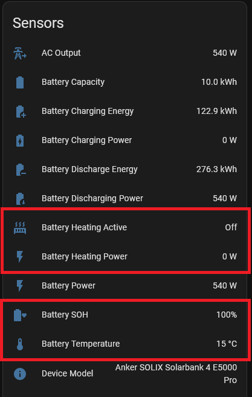
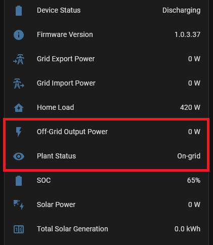
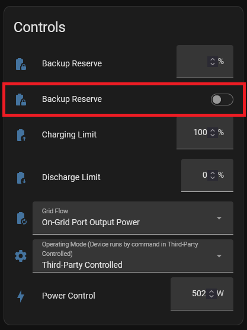

# Anker SOLIX Extras Integration for Home Assistant

Additional sensors and controls for batteries configured in the
[official Anker SOLIX integration](https://github.com/anker-charging/ha-anker-solix-official).

Extras runs alongside the official integration and adds entities to your
existing battery's device page. Your existing sensors, controls, and settings
continue to work as before.

This is an independent community project, not developed or supported by Anker.

## Preview

Extras entities are outlined in red on the battery's device page in Home Assistant.

  
  
  

## Sensors & Inputs

| Sensor | Description | Display | Source |
| --- | --- | --- | --- |
| Battery Temperature | The internal battery temperature, averaged across installed units | °C, whole degrees by default | Input register 10156, INT16 |
| SOH | Combined state of health reported by the battery system. Shown under Diagnostic and enabled by default. | % | Input register 10015, UINT16 |
| Plant Status | Operating status reported by the battery system | 1 = On-grid / 2 = Off-grid / 3 = Standby / 4 = Fault | Input register 10000, UINT16 |
| Battery Heating Power | Estimated from battery and AC power during AC absorption; may include conversion losses or other consumption | W, whole watts by default | Calculated |
| Off-Grid Output Power | Experimental active power from the off-grid port. Enabled automatically on the Solarbank 4 E5000 Pro. Other supported models can opt in for testing. | W, whole watts by default | Input registers 10233–10234 (FC04), INT32 |
| Backup Reserve Enable | A switch to turn on the Battery Reserve function | 0 = disabled / 1 = enabled | Holding register 60003, UINT16 |
| Total Battery Charge / Discharge Energy | Lifetime plant battery energy totals from the published registers | kWh | Input registers 10022 and 10024, UINT32 |
| Total Load Consumption / Grid Import / Grid Export Energy | Lifetime totals for load consumption, energy bought from the grid, and energy fed into the grid | kWh | Input registers 10026, 10030, and 10034, UINT32 |
| PCS Count / Available PCS Count | Total and available power conversion systems | Count | Input registers 10040 and 10041, UINT16 |
| System Time / Sync System Time | Shows the battery clock and provides a button to set it to Home Assistant's current time | Timestamp / button | Holding registers 10060–10061 |
| Export Power Limitation / Export Power Limit | A switch to apply the device's export limit and a separate control for the limit in whole watts | On / off and W | Holding register 10074 (UINT16) and 10075–10076 (INT32) |

The energy totals, PCS counts, clock, and export limit are added automatically
on Solarbank Max, Solarbank Max AC, XE, and XE AC, the models listed in the
[Anker SOLIX Modbus protocol](https://salesforce-knowledge-download.s3.us-west-2.amazonaws.com/000039871/en_US/000039871.pdf).
On other supported models, turn on **Enable Plant Modbus Entities (beta)**
in the Extras integration options to try these entities. Availability depends
on the device and firmware. Hardware verification in Extras is pending.
PCS Count, Available PCS Count, and System Time are diagnostic sensors disabled
by default. Enable them from the device's entity list. Extras excludes
Available PCS Count on the Solarbank 4 E5000 Pro after one unit reported
fluctuating values in the thousands.

Anker labels System Time as a
timestamp without specifying its encoding. Extras interprets it as a
high-word-first Unix timestamp in seconds and requires a valid clock reading
before allowing synchronization. The clock sync button and both export limit
controls are disabled by default. Enable them from the device's entity list if
you want to use them. Each change is checked against the device's readback.

## Important

**Extras uses features outside Anker's officially published and supported Modbus
interface.** Compatibility may vary between devices and firmware versions.
Use this integration at your own risk. The contributors and maintainers accept
no responsibility for damage to your device or other loss resulting from its use.

## Requirements and compatibility

- Home Assistant **2026.10.4 or newer**.
- **Anker SOLIX Official** installed and configured.
- An enabled battery device in the official integration.
- Local Modbus TCP enabled in the Anker app, with the battery reachable from
  Home Assistant. Extras uses your existing connection settings.

These are the models offered during setup:

| Model | Compatibility |
| --- | --- |
| Solarbank 4 E5000 Pro | Fully compatible |
| Solarbank Max AC | Inferred from the official integration's shared register map |
| Solarbank Max | Inferred from the official integration's shared register map |
| XE / XE AC | Inferred from the official integration's shared register map |

If you own a model I have not yet marked as confirmed compatible, you can open a discussion to confirm compatibility or open a pull request to update this documentation.

Smart plugs and meters are not supported.

## Installation

### Install with Marketplace (recommended)

Or, in **Settings → Marketplace**, search for `Anker SOLIX Extras` under
**Integrations** and select **Install**. On Home Assistant 2026.10, search in
**HACS** and select **Download**.

1. Restart Home Assistant if prompted.
2. If setup doesn't open automatically, go to **Settings → Devices & services**,
   select **Add integration**, and search for **Anker SOLIX Extras**.
3. Select the battery already configured in **Anker SOLIX Official**. The new
   entities appear on your battery's existing device page.

Marketplace and HACS track updates automatically.

### Manual Installation

More Details

- Download `anker_solix_extras.zip` from the latest [published release](https://github.com/MattCheetham/HA-Anker-Solix-Extras/releases/latest).
- Extract the `anker_solix_extras` folder into your Home Assistant configuration
  directory's `custom_components` folder. The resulting path is
  `<config directory>/custom_components/anker_solix_extras/`.
- Restart Home Assistant.
- Go to **Settings → Devices & services**, select **Add integration**, and search
  for **Anker SOLIX Extras**. Select the battery already configured in
  **Anker SOLIX Official**.

## Using the additional sensors

After setup, open your battery's existing device page to find the Extras sensors.
You can add them to dashboards and automations like any other Home Assistant
sensor. Existing dashboards and automations continue to use their original
entities; Extras does not replace them automatically.

On other supported models, open **Settings → Devices & services →
Anker SOLIX Extras → Configure** and turn on **Enable Off-Grid Output Power
(beta)** for the battery you want to test. Saving reloads Extras and adds the
sensor to that battery's device page. Readings may be unavailable or inaccurate
on these models. Turning the option off stops polling for this sensor.

## Viewing the Modbus connection

As a Home Assistant administrator, open **Settings → Connectivity → Modbus**.
The battery's TCP endpoint lists **Anker SOLIX Extras** as a consumer on
unit **1**. Existing Extras entries register automatically after updating and
restarting Home Assistant. Extras uses the address and port from the linked
Anker SOLIX Official entry. See the [Home Assistant Modbus documentation](https://www.home-assistant.io/connectivity/modbus/#viewing-your-modbus-connections).

## Polling interval

Extras reads state from your battery every **10 seconds** by
default. Choose a custom interval during setup, or change it later under
**Settings → Devices & services
→ Anker SOLIX Extras → Configure**. Enter a whole number of seconds, at least 1.
The setting applies only to Extras for the selected battery.

Saving a changed interval reloads Extras automatically and preserves your entity
IDs. Shorter intervals increase the number of Modbus requests to the battery.

## Removing Extras

1. Update any dashboards or automations that use Extras entities before removing
   the integration.
2. In **Settings → Devices & services**, remove **Anker SOLIX Extras**.
   This removes its entities while leaving the official integration and device
   in place.
3. Uninstall Extras through **Marketplace / HACS**, then restart Home Assistant.
   For a manual installation, delete only `custom_components/anker_solix_extras`
   before restarting.

**Keep the official integration and the battery device.** You do not need to
delete either to remove Extras.

## Troubleshooting

- **No batteries offered:** check the official integration has loaded, its device
  is enabled, and its model matches the compatibility table above.
- **Sensors unavailable or setup fails:** check the battery's connection and
  that the official integration is working. Reload Extras after restoring the
  connection. Some firmware versions may not provide the additional readings.
- **Duplicate sensors:** another integration may already provide the same
  measurement. Choose which entity to use in your dashboards and automations.
- **Official integration was deleted and added again:** remove the old Extras
  entry and set up Extras again, selecting the newly configured battery.
- **Reporting an issue:** include model, firmware, Core and Extras versions,
  whether the official integration works, and relevant redacted logs. Remove
  IP addresses and serial numbers before posting them publicly.

## Contributing

See [CONTRIBUTING.md](CONTRIBUTING.md) for development, testing, and pull request
guidance. All changes go through review before merging into `main`.

AI was used extensively while building this project. Similar AI driven contributions are welcome but please use your best judgement. Submitted code must have a thorough test suite and will be reviewed before merging.

## Licence

Anker SOLIX Extras is licensed under the [MIT License](LICENSE) by its contributors.
The icon and wordmark adapt [original artwork from Anker Innovations](https://github.com/anker-charging/ha-anker-solix-official/tree/main/custom_components/anker_solix_official/brand).
The [third-party artwork notice](custom_components/anker_solix_extras/brand/THIRD_PARTY_NOTICES.md) contains the upstream attribution and license text.
